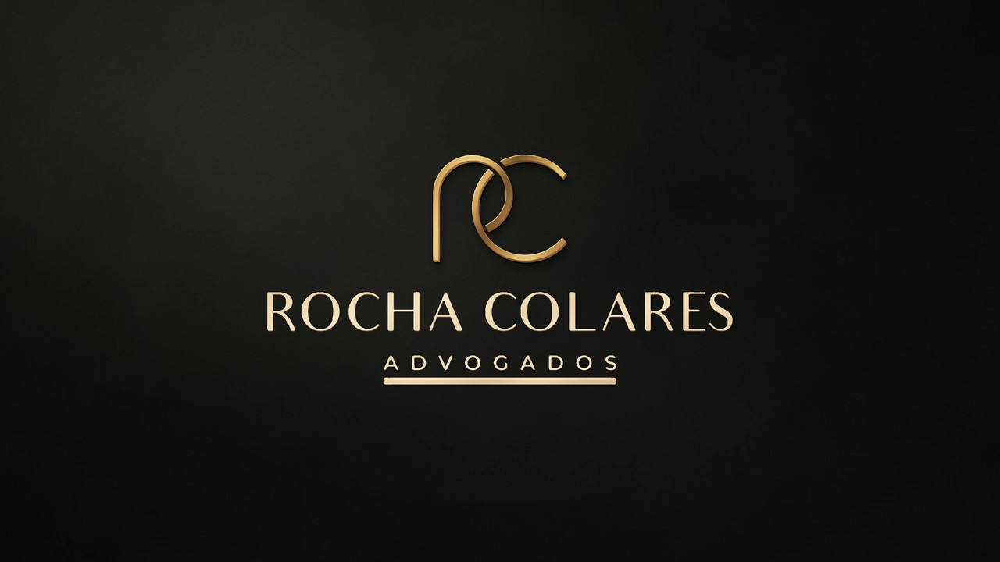

# Rocha Colares Advogados

Site institucional de advocacia trabalhista em português. Desenvolvido em React 19 e TypeScript com Vite, Tailwind CSS, GSAP e Lenis. Requer Node.js 22.12+ e npm.



## Estrutura

| Pasta | Conteúdo |
| --- | --- |
| `src/config/` | Identidade, canais de contato e domínio |
| `src/content/` | Textos sobre direitos, atendimento e dúvidas frequentes |
| `src/components/` | Seções do site, formulários e animação de abertura |
| `src/routes/` | Página inicial, privacidade e página de erro |
| `src/styles/` | Tipografia, cores, composição e responsividade |
| `public/assets/` | Fotos, texturas, ícones e variações da marca |
| `scripts/` | Geração dos placeholders de imagem durante o build |
| `design/abertura/` | Composição editável em PSD, capa e prévia em vídeo |

## Rodar e publicar

```sh
npm install
npm run dev
```

Execute `npm run build` para gerar `dist/` e `npm run preview` para abrir a versão de produção. Na Vercel, importe o repositório `solutionsnovaai-bit/rochacolares-advogados` a partir da branch `main` e use a raiz do repositório. O arquivo `vercel.json` define o preset Vite, o build e a pasta `dist`. O deploy funciona com as configurações padrão, sem credenciais de serviços externos. Em outra hospedagem estática, encaminhe as rotas de navegação para `index.html` e sirva os arquivos de mídia diretamente.

## Personalizar

O WhatsApp do escritório é +55 (11) 95100-7967. A navegação, a triagem e o formulário usam o mesmo número de `src/config/site.ts`. Para trocar o número, mantenha DDI e DDD. Se ele for removido, os botões levam à seção de contato e o visitante pode copiar a mensagem preparada. O texto da marca no logo vem do arquivo original fornecido.

Edite os temas, etapas e perguntas em `src/content/labor.ts`. Os textos de abertura estão em `src/components/hero/Hero.tsx`. A política de privacidade está em `src/routes/Privacy.tsx` e deve refletir a operação do escritório e da hospedagem escolhida.

Substitua as fotos WebP em `public/assets/img/` e as variantes do logo em `public/assets/logo/`, mantendo os nomes. O original está em `public/assets/logo-original.webp`. Atualize também os favicons e `public/og-image.jpg` se alterar a marca. O build recria os placeholders LQIP com Sharp. O sitemap usa `siteUrl` ou o domínio de produção informado pela Vercel. Sem domínio configurado, ele permanece sem URLs.

## Marca de abertura

A abertura usa as camadas de `public/assets/logo/intro/`. O monograma e seu reflexo compartilham o mesmo enquadramento para que a luz acompanhe as curvas do RC. O nome e a assinatura têm transparência independente. `lockup-master.png` reúne a marca inteira em fundo transparente. A textura de fundo está em `public/assets/img/intro-surface.webp`. A sequência e os tempos de câmera estão em `src/components/loader/Loader.tsx`.

O arquivo `design/abertura/Rocha-Colares-Motion.psd` contém a composição em seis camadas. Para animar no After Effects, importe-o como composição com os tamanhos de camada preservados. A prévia está em `design/abertura/Rocha-Colares-Abertura.mp4`.

## Privacidade da triagem

Os formulários usam apenas o estado local da página. Ao escolher abrir o WhatsApp, o visitante transfere o texto preparado ao aplicativo e decide se deseja enviá-lo. Não há API de envio nem banco de dados nesta aplicação. O indicador do loader é salvo no armazenamento de sessão.

## Referências do conteúdo

- [Provimento 205/2021 do Conselho Federal da OAB](https://www.oab.org.br/leisnormas/legislacao/provimentos/205-2021)
- [Constituição Federal, art. 7º, XXIX](https://www.planalto.gov.br/ccivil_03/constituicao/constituicao.htm)
- [Consolidação das Leis do Trabalho](https://www.planalto.gov.br/ccivil_03/decreto-lei/del5452.htm)
- [Lei Geral de Proteção de Dados](https://www.planalto.gov.br/ccivil_03/_ato2015-2018/2018/lei/l13709.htm)
